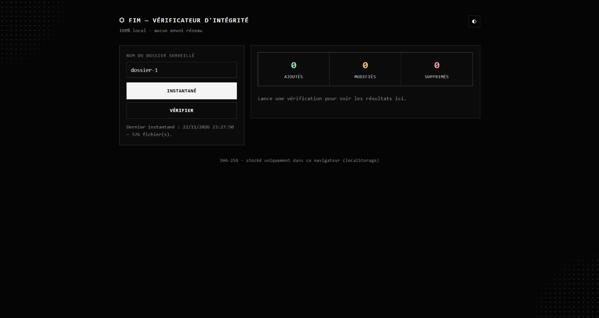
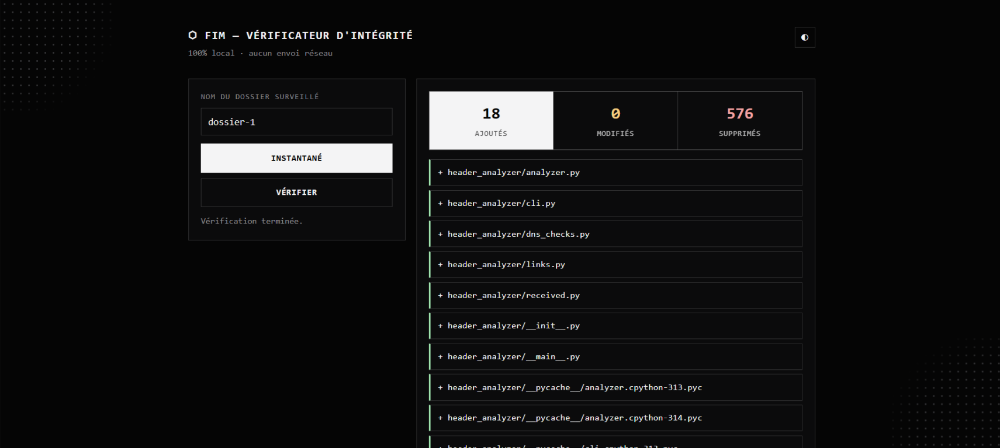

# FIM - Vérificateur d'intégrité de fichiers

Un outil simple pour repérer les fichiers ajoutés, modifiés ou supprimés dans un dossier. Il fonctionne entièrement dans le navigateur, sans serveur ni dépendance.

## Utilisation

1. Téléchargez ou clonez ce dépôt.
2. Ouvrez `fim.html` dans un navigateur basé sur Chromium, comme Chrome, Edge ou Brave.
3. Saisissez un nom pour identifier l'instantané, puis cliquez sur **Instantané** et sélectionnez le dossier à surveiller.
4. Après avoir modifié le dossier, cliquez sur **Vérifier** et sélectionnez à nouveau le même dossier.
5. Consultez les fichiers ajoutés, modifiés ou supprimés. Cliquez sur un compteur pour filtrer les résultats par catégorie.

## Fonctionnement

Le navigateur calcule l'empreinte **SHA-256** de chaque fichier et compare les empreintes avec l'instantané enregistré. Les instantanés sont stockés dans le `localStorage` du navigateur, sous le nom choisi.

Tout le traitement est local : aucun fichier ni résultat n'est envoyé sur le réseau. L'application est contenue dans un fichier HTML autonome.

## Limites

- La sélection de dossiers utilise `webkitdirectory` et nécessite un navigateur compatible, notamment Chrome, Edge ou Brave.
- La vérification est manuelle : elle ne surveille pas le dossier en continu.
- Les instantanés sont conservés dans le navigateur et sur l'appareil utilisés pour les créer.
- Le calcul des empreintes peut prendre du temps pour les dossiers volumineux.

## Licence

MIT. Projet éducatif.
